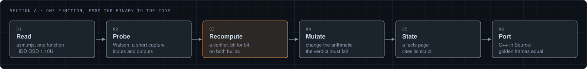
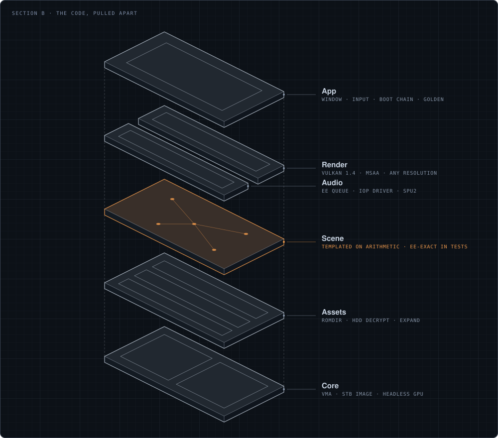
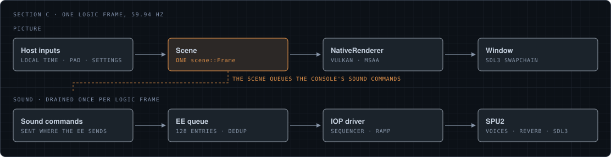
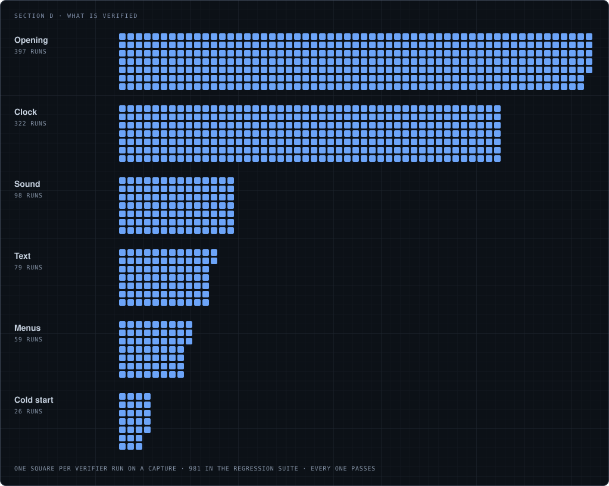

<p align="center">
  
  <h1 align="center">CrystalOSD</h1>
  <p align="center">
    <strong>The PlayStation 2 system menu — the Crystal Clock, the menus, the boot intro — measured from the console's own code and rebuilt in native C++26 and Vulkan.</strong>
  </p>
  <p align="center">
    <a href="https://github.com/JeanxPereira/CrystalOSD/actions/workflows/build.yml"></a>
    
    
    
    
    
  </p>
</p>

---

CrystalOSD runs the PS2's OSDSYS as a native Windows app: twelve glass rods around a sphere, seven orbs leaving trails, the framebuffer refracted through the blocks, System Configuration with its glass cubes, the Version page, the boot intro, and the sound, all on your local time at 59.94 Hz. Nothing is emulated at run time. The canon build is **HDD OSD 1.10U**; **ROM 2.30** is a second witness, and every address names the build it belongs to.

It is a reimplementation, not a matching decompilation: every value has to earn its place in the code.

<p align="center">
  
  
</p>

## How a value enters the code

A number reaches `Source/` only after a script recomputes what the console computed, from inputs probed in an instrumented PCSX2 ([Watson](https://github.com/JeanxPereira/Watson)), bit for bit and on both builds. A verifier must fail when its arithmetic is mutated, so it cannot pass by accident.

<p align="center"></p>

The C++ then answers to the golden gate: a scripted session replayed headless, every frame's scene, pixels and audio hashed against a recorded run.

## The code

<p align="center"></p>

The **Scene** is plain C++ templated on its arithmetic: `EeArithmetic` reproduces the EE (round toward zero, no denormals, its own sine) and is held bit for bit against the verifiers in the tests; the window runs `NativeArithmetic`. **Assets** decodes the console's raw files at each start (ROMDIR, the HDD container decrypt, Expand). **Audio** runs the EE sound queue, the IOP driver and the SPU2.

<p align="center"></p>

## What is verified

<p align="center"></p>

What is still open is listed, line by line, in [`facts/README.md`](facts/README.md). The Browser is in progress on its own branch.

## Build and run

Requires Windows 11, LLVM/Clang 23, Visual Studio 2026 (for the Windows SDK and Ninja), CMake 4.2+ and the Vulkan SDK 1.4.

```powershell
git clone --recursive https://github.com/JeanxPereira/CrystalOSD.git
cd CrystalOSD
tools\build.ps1 configure app
tools\build.ps1 build app-release
bin\CrystalOSD.exe
```

The console's raw resource files (`TEXIMAGE`, `FNTOSD`, `SNDIMAGE`, `ICOIMAGE`, `JISUCS`, `SKBIMAGE`, `hddosd.elf`) are in `Resources/`, as the OSD loads them; `--bios <rom.bin>` or `--resources <dir>` takes your own.

| Flag | Does |
|---|---|
| `--skip-boot`, `--clock` | Start at the main menu, or at the clock alone |
| `--pal`, `--language N`, `--aspect N` | Video mode and console settings for this run |
| `--golden record\|check <file>` | Record or check the golden frames |
| `--soak N`, `--validate sync` | An unattended session; Vulkan validation |

Settings live in `%LOCALAPPDATA%/CrystalOSD/settings.json`.

## Where to look

| Question | Where |
|---|---|
| What the console does, with its proof | [`facts/README.md`](facts/README.md) |
| Every verifier and its result per build | [`facts/verification.md`](facts/verification.md) |
| One function of the disassembly | `node References/scripts/asm.mjs <name\|0xADDR> --callers --rom` |
| The tests and the regression suite | `tools\build.ps1 test tests-debug`, `node References/scripts/run_all.mjs` |
| Contributor rules | [`CLAUDE.md`](CLAUDE.md), [`docs/workflow.md`](docs/workflow.md) |

`python tools/readme_assets.py` redraws the figures; the progress grid is counted from the regression suite.

## License

CrystalOSD is free software under the [GNU General Public License v3.0](LICENSE). It covers this code only: the console's data in `Resources/` is Sony's. CrystalOSD is an independent project and is not affiliated with Sony Interactive Entertainment. Successor of [CrystalClockVK](https://github.com/JeanxPereira/CrystalClockVK-Legacy) and of the [decompilation](https://github.com/JeanxPereira/CrystalOSD-Decomp-Legacy).

---

<p align="center">
  Made by <a href="https://github.com/JeanxPereira">JeanxPereira</a>
</p>
